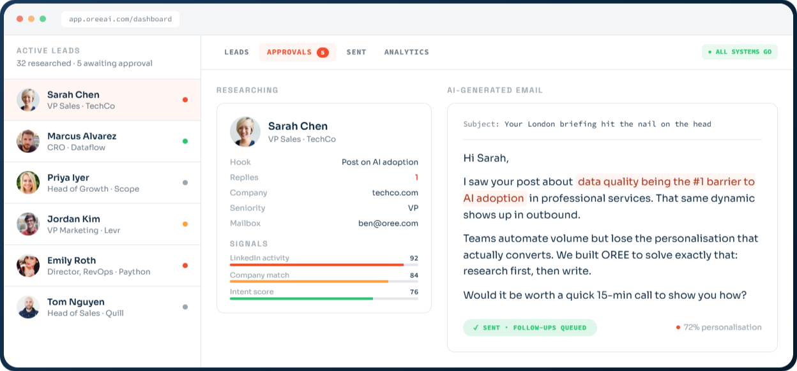
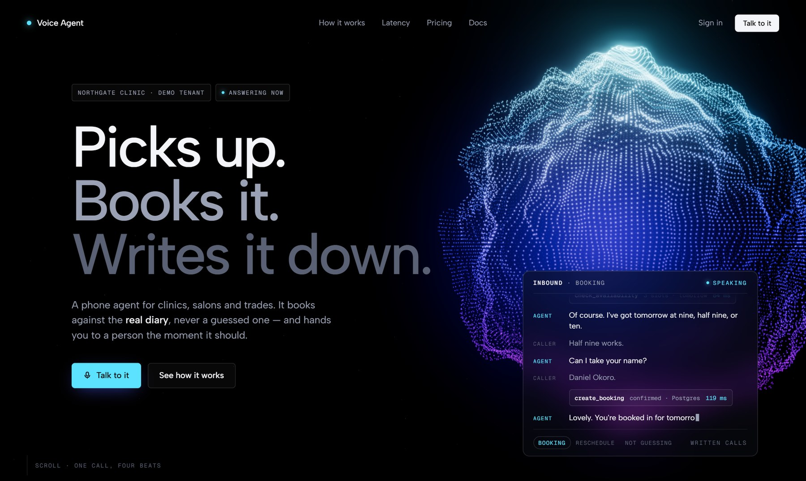
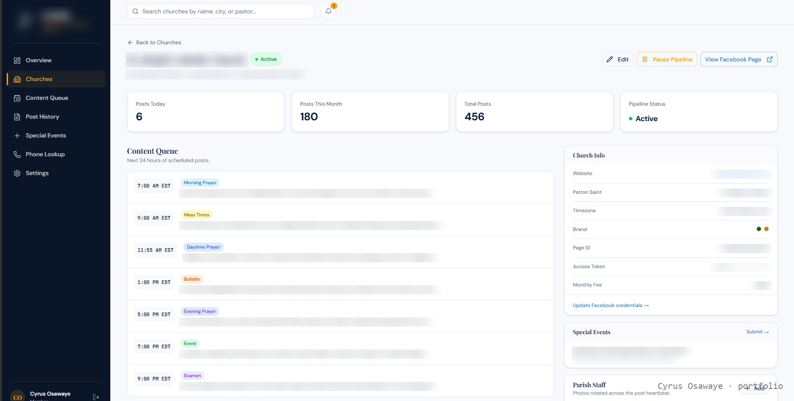
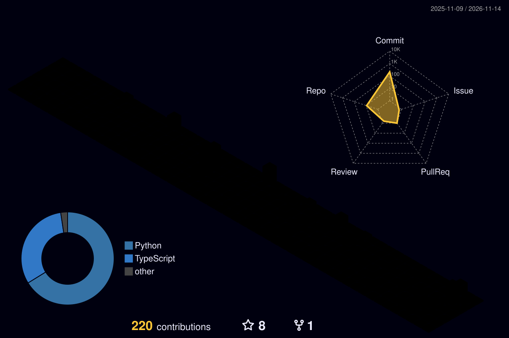

<!--
  Profile README for github.com/cypher125.

  Copy rules: every number comes from the portfolio's lib/projects.ts and
  lib/site.ts, which record the source of each one - do not add a figure that
  is not there. No years of experience. On OREE say "I built the backend"
  (or "backend lead") - never "my company" or "CTO". No client names.

  Every portfolio link is in the reference block at the bottom, so a domain
  change is one edit. The banner is generated by portfolio/brand/github_banner.py.
  The 3D graph and the snake are rebuilt daily by
  .github/workflows/profile-graphics.yml and published to the `output` branch.
-->

[][site]

<div align="center">
  <picture>
    <source media="(prefers-color-scheme: dark)" srcset="https://readme-typing-svg.demolab.com?font=JetBrains+Mono&amp;weight=500&amp;size=18&amp;duration=2800&amp;pause=1000&amp;color=FF8A3D&amp;center=true&amp;vCenter=true&amp;width=700&amp;height=34&amp;lines=I+build+AI+systems%2C+full-stack+software+and+automation;B2B+lead+systems%3A+research%2C+scoring+and+outreach;Voice+agent+live+in+production%3A+2%2C109+ms+median+turn;Built+the+backend+of+OREE%2C+a+~180k-line+AI+SaaS">
    
  </picture>
</div>

<div align="center">

[][site]
[][upwork]
[][oree]

</div>

## About

I am a software engineer who builds AI systems. Most automation people cannot build the application; most developers do not do automation. I ship both - Django and Next.js applications on one side, n8n pipelines and voice agents on the other - and the systems below are the intersection.

- **AI systems:** agents, RAG and MCP tools ([Axion-Code][axion], [code review agent][cra], [two RAG stacks][card-rag])
- **Software:** full-stack Next.js, Django and FastAPI apps ([OREE][oree], [tizOS][card-tizos], [PayLink][card-paylink], [AspireBridge][card-aspire], [Chemoventry][card-chemo])
- **Automation:** n8n pipelines and integrations (17 systems, 831 nodes)
- **Voice agents:** [live in production][card-voice], 2,109 ms median turn
- **B2B lead systems:** lead research, scoring and outreach ([OREE][oree], [ICP-tiered outreach][card-icp])

> Most automations fail quietly. The run finishes green and nothing actually happened. I build the check that catches that, and I document the system on the canvas so your team can maintain it without me.

[][work]

## Selected work

<sub>The full write-up for each, with the engineering notes, is on the [portfolio][work].</sub>

### OREE

**Live at [oreeai.com][oree]** · AI sales co-pilot · I built the backend

[][oree]

It started as 7 n8n workflows and 228 nodes, and it worked. It stopped being the right shape once the product needed accounts, billing and state that a canvas should not own, so I made the call to rebuild it as an application. It researches each lead, scores the signal, drafts the email and the LinkedIn sequence with a stated reason the message lands, and sends inside a 9am-5pm recipient-local window. Nothing sends until a human approves it.

`~180,000 lines of code` &nbsp; `56+ Django models` &nbsp; `228 nodes in the n8n original`

<sub>Django + DRF · PostgreSQL + pgvector · Celery + Redis · three Next.js apps · Docker. The screenshot is the product as shown on oreeai.com.</sub>

### Voice booking agent

**Live in production** · private

[][card-voice]

Answers the phone, books into a real calendar, and hands the outcome to n8n over a signed webhook. Six intents: book, reschedule, cancel, hours and location, take a message, escalate. Every call becomes a record: what was said, how long each silence lasted, which tools ran and how fast, and what was extracted afterwards.

[][card-voice]

`2,109 ms median turn` &nbsp; `749 automated tests` &nbsp; `6 live intents`

<details>
<summary><b>The bug worth telling</b></summary>
<br>

Bookings flowed out to Google Calendar and nothing came back. Both halves were healthy in isolation and every test passed - the gap existed only between them, so the agent would book a caller over the owner's holiday and confirm it. I fixed it and then proved it against the real calendar rather than asserting it: open 09:00-12:30 is 7 possible slots, Google busy 12:00-16:00, production `check_availability` returned 6. The missing slot is exactly the one the block covers.

</details>

<sub>FastAPI on Modal · Neon Postgres · Claude Haiku 4.5 · Deepgram Flux · Google Calendar · HMAC-SHA256 webhooks. Both screens are from the design files the frontend was built from, with sample data; Northgate Clinic is the demo tenant. Turn latency is the measured median on clean audio.</sub>

### Content pipeline and operations dashboard

**Private, client work** · one engagement, both halves

[][card-pipeline]

An n8n publishing pipeline and the Next.js screen the client runs it from. The pipeline fills seven scheduled slots a day per tenant and fans each post out across platforms; the dashboard is where the client actually works. Most automation people stop at the canvas and hand over a workflow nobody can operate.

`456 posts published` &nbsp; `180 per month` &nbsp; `7 slots per day`

<sub>n8n · Next.js · FastAPI · Meta Graph API · multi-tenant. Client identifiers are cropped or redacted.</sub>

### tizOS

**Private, client work** · multi-brand AI content platform · built solo

[][card-tizos]

Phone footage and a voice note go in; finished, on-brand videos come out. It describes every clip moment by moment, plans the videos worth making and shows its reasoning before anything is made, and enforces the brand's rules in code after the model answers rather than trusting the prompt. Then a second AI pass reads each video with the opposite brief - find problems, not reasons to approve - and a finding that breaks a rule blocks approval.

`5 networks, one login` &nbsp; `2 AI passes: plan, then critique` &nbsp; `30 days of nightly backups`

<sub>Next.js · FastAPI · PostgreSQL · Redis queue · FFmpeg · faster-whisper · Claude API. The client's brands, footage and places are blurred.</sub>

### Parallel market research

**Private, client work** · n8n

[][card-research]

Five scrapers running at once, a merge that waits for all of them, and a checkpoint - the red block - that hard-fails rather than reporting on thin data. A research report built on four reviews is worse than no report, because someone will act on it.

`5 scrapers in parallel` &nbsp; `36 nodes` &nbsp; `8 typed output tabs`

<sub>Opened from exported workflow files in my own instance - credentials do not travel with an export. The warning icons are missing keys, not broken nodes. The client's name, the engagement dates and the contract value are blurred.</sub>

### Axion-Code

**Open source** · [code][axion] · [PyPI][axion-pypi]

An autonomous coding agent that runs in the terminal, reads a codebase, writes code and runs commands. Claude, GPT, Grok, OpenAI Codex or any local model through Ollama, with a cost budget, a permission mode that asks before dangerous operations, and resumable sessions.

```console
$ pip install axion-code
$ axion login                # one time, saved to ~/.axion/credentials/
$ axion -m opus              # pick the model
$ axion --budget 1.00        # cap the spend
$ axion -p "Find and fix the bug in auth.py"
```

`5 model providers` &nbsp; `MIT` &nbsp; `published on PyPI`

## More systems

<sub>Each one has a full card on the [portfolio][work]. Private work links there; public work links to the code.</sub>

#### Automation and AI

| System | What it does | Numbers |
| --- | --- | --- |
| **[WhatsApp booking agent][card-whatsapp]** | An intent router, four booking branches, and an error path that stops rather than passing bad data on | 53 nodes · 4 branches |
| **[Two RAG stacks][card-rag]** | Keeps a vector store in step with a live folder, including the delete path almost nobody builds, and reranks rather than trusting raw vector distance | 2 vector stores · 3 file types |
| **[Async video publishing][card-async]** | Polls a minutes-long render and branches on failure instead of hanging and hoping | 120 s poll · 6 networks |
| **[ICP-tiered outreach][card-icp]** | Two lead feeds, fuzzy deduplication, ICP tiers, retrieval-based personalisation and a nine-step follow-up | 68 nodes · 3 tiers |
| **[Instagram inbox routing][card-instagram]** | Comments, story replies and DMs classified and routed to the right team, with a fallback branch so nothing drops | 5 message types · 4 routes |
| **[Trend-driven video][card-trend]** | Scores what is trending, matches it to real news, renders and posts, and feeds performance back into selection | 3 news sources · 1 feedback loop |
| **[n8n as an application backend][card-backend]** | 161 nodes serving a live site, with attribution that survives an anonymous visitor becoming a lead | 12 webhooks · ~54 DB operations |
| **[Renderly][renderly]** | A Django REST API that renders video: Vertex AI Veo 3 for the B-roll, a HeyGen avatar composited over it | 202 then poll · 5 job states |
| **[Code review agent][cra]** | Reviews a repository for quality, security and performance, and runs as an MCP server so another model can call it | 15+ languages · MCP |
| **[FacMan][facman]** | A REST API over the Facebook Graph API v18: multi-page management, publishing, analytics and messaging | public repo |

#### Applications

| Product | What it is | Code |
| --- | --- | --- |
| **[PayLink][card-paylink]** | A fintech wallet: airtime, data, electricity, cable TV and exam pins paid from a funded balance, behind a transaction PIN and KYC, with VTPass for the bill payments | [frontend][paylink-fe] · [API][paylink-api] · 15 endpoints |
| **[AspireBridge][card-aspire]** | A mentorship and internship platform for YABATECH, with real users, written against an OpenAPI contract | [frontend][aspire-fe] · [API][aspire-api] |
| **[Chemoventry][card-chemo]** | Chemical inventory where the domain model is the work: hazard data, reactivity groups, physical state, expiry, and an audit log on every change | [frontend][chemo-fe] · [API][chemo-api] |

## Stack

<sub>Only tools with a shipped system behind them.</sub>

<div align="center">


<br>


</div>

## What a client said

<div align="center">

[][upwork]

<sub>Upwork, 5.0. Both halves of the thesis, named by the client. More reviews on the [portfolio][site].</sub>

</div>

## On GitHub

<sub>Most of my work is in private client repositories.</sub>

<div align="center">



<picture>
  <source media="(prefers-color-scheme: dark)" srcset="https://raw.githubusercontent.com/cypher125/cypher125/output/snake-dark.svg">
  
</picture>

</div>

<div align="center">

[][upwork]
[][site]
[][contact]


</div>


[site]: https://osawayecyrus.vercel.app
[work]: https://osawayecyrus.vercel.app/#work
[contact]: https://osawayecyrus.vercel.app/#contact
[card-voice]: https://osawayecyrus.vercel.app/#voice-booking-agent
[card-pipeline]: https://osawayecyrus.vercel.app/#content-pipeline
[card-tizos]: https://osawayecyrus.vercel.app/#tizos
[card-research]: https://osawayecyrus.vercel.app/#market-research-pipeline
[card-whatsapp]: https://osawayecyrus.vercel.app/#whatsapp-booking-agent
[card-rag]: https://osawayecyrus.vercel.app/#rag-document-pipeline
[card-async]: https://osawayecyrus.vercel.app/#async-video-pipeline
[card-icp]: https://osawayecyrus.vercel.app/#icp-outreach-pipeline
[card-instagram]: https://osawayecyrus.vercel.app/#instagram-inbox
[card-trend]: https://osawayecyrus.vercel.app/#trend-video-pipeline
[card-backend]: https://osawayecyrus.vercel.app/#n8n-application-backend
[card-paylink]: https://osawayecyrus.vercel.app/#paylink
[card-aspire]: https://osawayecyrus.vercel.app/#aspirebridge
[card-chemo]: https://osawayecyrus.vercel.app/#chemoventry

[upwork]: https://www.upwork.com/freelancers/~015d16f34a8eeb1ea7
[oree]: https://oreeai.com
[axion]: https://github.com/cypher125/Axion-Code
[axion-pypi]: https://pypi.org/project/axion-code/
[renderly]: https://github.com/cypher125/Renderly
[cra]: https://github.com/cypher125/code-review-agent
[facman]: https://github.com/cypher125/FacMan
[paylink-fe]: https://github.com/cypher125/PayLink
[paylink-api]: https://github.com/cypher125/PaylinkApi
[aspire-fe]: https://github.com/cypher125/AspireBridge
[aspire-api]: https://github.com/cypher125/AspireBridge-Api
[chemo-fe]: https://github.com/cypher125/Chemoventry
[chemo-api]: https://github.com/cypher125/chemoventoryapi
